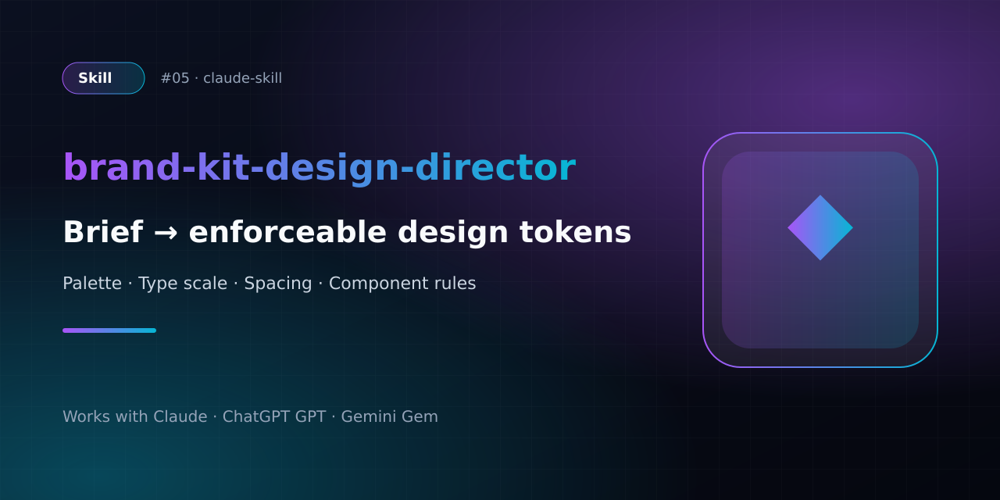

<p align="center"><a href="https://cloudskillhub.com"></a></p>

# brand-kit-design-director

🌐 **Website:** [cloudskillhub.com](https://cloudskillhub.com) · 📦 **All skills:** [skillhub](https://github.com/jahirulofficial0/skillhub)

Turn any brand brief into an enforceable design-token kit — palette, type scale, spacing, component rules, do/don't list — so every AI-generated design stays on-brand.

**Works with:** Claude (Code, Desktop, claude.ai) · ChatGPT custom GPT · Gemini Gem

## Install

### Claude Code — this skill only
```
/plugin marketplace add jahirulofficial0/skillhub
/plugin install brand-kit-design-director@skillhub
```
Or directly from this repo: copy `skills/brand-kit-design-director/` into `~/.claude/skills/`.

### All 10 skills at once
See **[skillhub](https://github.com/jahirulofficial0/skillhub)** — one marketplace, or one MCP server that serves all 10 skills.

### claude.ai
Download `skills/brand-kit-design-director/` as a ZIP → **Settings → Capabilities → Skills → Upload skill**.

### ChatGPT / Gemini
- ChatGPT GPT: [`prompts/chatgpt-gpt.md`](prompts/chatgpt-gpt.md)
- Gemini Gem: [`prompts/gemini-gem.md`](prompts/gemini-gem.md)

## Usage
Just describe the task — the skill activates when relevant. Example:

> Brand: Cloud Tech — ISP & CCTV company. Premium, trustworthy, modern. Logo colour #0EA5E9. Dark-mode dashboard + social posts.

See [`examples/`](examples/) for a full input → output sample.

## What you get
```
## Brand Core
## Colour Tokens
| Token | HEX | Use | Contrast on bg |
## Type Scale
## Spacing / Radius / Shadow / Motion
## Component Rules
## Do / Don't
## Exports
```json
{ "color": { "primary": { "500": { "$value": "#..." } } } }
```
```css
:root { --color-primary-500: #...; }
```
## Brand Prompt Block (paste into any AI tool)
```

## Repository layout
```
.claude-plugin/plugin.json   Claude Code plugin manifest
skills/brand-kit-design-director/SKILL.md       The skill
prompts/                     ChatGPT GPT and Gemini Gem versions
examples/                    Sample input and output
assets/banner.png            Social preview image
```

## Author
**Jahirul** — [cloudskillhub.com](https://cloudskillhub.com) · [github.com/jahirulofficial0](https://github.com/jahirulofficial0)

## License
MIT — see [LICENSE](LICENSE).
